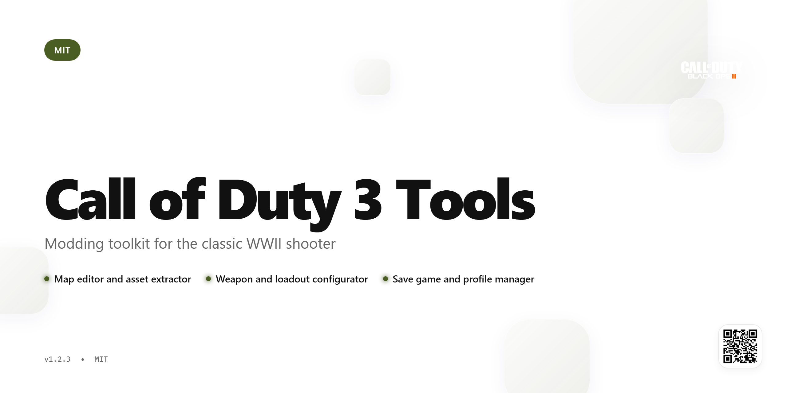

# Call of Duty 3 Asset Studio — Video Tool

### 💻 PowerShell Installer

   

---

Call of Duty 3 Tools pulls the Xbox 360 disc apart layer by layer — models, textures, sounds, skeletons — and lays the pieces out in a workflow you can actually see, with renders and catalogs that make each asset tangible. Every extraction is measured against captures from the running game, so what you get on screen is checked against what the console truly drew. The pipeline runs from unpacking archives through linking materials to building self-contained catalogs, each step feeding the next. Format notes travel alongside the code, so the structure behind the visuals stays open to inspection and improvement.

## 🔧 Requirements

- **PowerShell 5.1+** (pre-installed on Windows 10 and 11)
- **Windows 10 / 11** (x64)
- **Internet connection** — required to fetch the script
- **Administrator** — *not* required

## Features

**Pack reconnaissance:** Point the tools at a disc folder's archives (`.cod`) and they map the whole asset-pack layout from the pack header itself — every record and every GPU data block placed at its exact byte position, so the pipeline starts from ground truth rather than guesswork.

- **Geometry straight from the source:** Mesh extractors (`.xemesh`, `.xecell`) write OBJ files by name, pulling surfaces from the game's own records. Verified against captures of the running title, geometry lands exactly as drawn — world cells and multi-part weapon viewmodels included.

- **Assembled, not scattered:** Multi-part models are posed from skeleton rest data, and weapons take their first idle-animation frame so animated pieces rest where the game holds them. Numbered bone chains repeat a part at every link; pieces the pose parks out of sight are flagged as `hidden`.

- **Textures decoded true:** Xenos-tiled DXT1/DXT3/DXT5 and A8R8G8B8 data unswizzles to clean PNGs at the position the header dictates, then a linker binds materials to colour texture maps and writes the `.mtl`. Most of the surface coverage lands with the right look; the stubborn stragglers are listed openly.

- **Sound banks with their names intact:** Treyarch NSLB sound banks (`.wbk`) come out with filenames attached, ready to sort.

- **Animations unlocked by the game's own code:** An emulator runs the title's decoder to turn `.xeanim` data into motion, and the same trick recovers skeleton rest poses.

- **A catalog that keeps itself tidy:** The pipeline rolls everything up into a self-contained catalog grouped by category — characters, soldiers, weapons, vehicles, props, scenery, effects — with extra texture-swapped variants and vehicle-gun assemblies where the data supports them, and invisible placeholder shells left behind.

- **Picture sheets for fast review:** Contact-sheet and gallery renderers turn whole catalog categories into 30-model sheets, and per-model corrections found by eye (surface textures, turned or hidden parts, variant swaps) persist in a small JSON ledger so fixes stick between runs.

- **Parallel-friendly by design:** Long passes accept a shard flag to split work across processes, and the index can be rebuilt on its own without re-decoding everything.

- **Built to be checked:** Capture dumps from the running title are matched draw-by-draw to extracted surfaces through exact triangle lists and a fitted transform — residuals near zero mean the geometry is genuinely the game's.

## How It Works

The pipeline is built around a simple idea: **trust the disc, not your eyes.** Every stage reads the game's own records first, then checks the result against what the title actually draws on screen. Here's the journey an asset takes from archive to viewable file.

### 1. modding the container
Everything starts inside `.cod` archives — KAPF containers holding LZO1X-compressed chunks and APKF asset packs. The unpacker walks the pack header's type table (record counts, alignments, GPU flags) and lays out every record and every block of GPU data in table order. This isn't guesswork: the header tells you exactly where each surface, texture, and skeleton record sits, down to the byte.

### 2. Reading the geometry
Mesh records point to their vertices through 32-bit word offsets from the pack's data start. Positions come out as big-endian float3 in inches, Z up — Direct3D 9 style declarations, skinned vertices using a per-surface bone palette. Because the pack header pins each mesh block to its true GPU position, triangles assemble cleanly instead of scrambling by a vertex or two.

### 3. Placing the pieces
Multi-part models (weapons, vehicles, gear) need their skeletons. Rest poses are recovered by running the title's own skeleton code inside an emulator, then parts are posed with the first frame of their idle animation. A numbered bone chain — `tag_b`, `tag_b01` … `tag_b18` — means a part is drawn at every bone in the chain, so a machine-gun belt curves the way the game holds it. Parts the idle pose parks out of sight are flagged `hidden` rather than dropped silently.

### 4. Decoding the pixels
Textures are Xenos-tiled DXT1/DXT3/DXT5/A8R8G8B8, byte-swapped, each placed at the exact offset the pack header gives. Material records supply most texture links; runtime placeholders (soldier heads and bodies) get resolved the same way the game does. Lower detail levels inherit from a sibling LOD backed by a record, so a helmet reads identically at every distance.

### 5. Checking against the running game
This is the part that keeps the tools honest. The game runs under a capture layer, and each draw call is matched to an extracted surface by its exact triangle list — the title's own index buffer. One transform is then fitted from the extracted vertices to the clip-space positions the game drew. A residual near zero means the geometry is the game's, byte for byte. Parts of a multi-part model must share their parent's transform, or the check fails.

### 6. Cataloging the results
Once extracted, models are grouped into categories, linked to their textures, and rendered into contact sheets for visual review. Per-model corrections found by eye live in a single fixes file: surface overrides, part rotations, hidden parts, texture variants, and vehicle assemblies joined at the offset their skeleton tags provide. The catalog skips invisible placeholder geometry (anything under a centimeter).

The whole loop — unpack, extract, link, catalog, audit — runs as one continuous pass, so a correction to the fixes file propagates through every downstream step the next time you run it.

## Workflow

Start by unpacking the archives: run `/extract_all.py` against your own disc folder, pointing it at a work directory. Every pack spills its contents into that folder, indexed by name — meshes, textures, sounds, skeletons, all of it sitting side by side. From there you walk the pipeline stage by stage: `extract_models.py` turns each `.xemesh`/`.xecell` into an OBJ, `extract_textures.py` decodes every `.xetex` into PNGs, and `link_textures.py` stitches material records to their colour textures so each OBJ arrives wearing an `.mtl` that points somewhere real. Feed the whole thing through `relink_all.py` when you want the linking, cataloging, and auditing done in one sweep.

Long extractions can be split across processes with `-shard=K/N`, so a full disc pass doesn't have to sit on one core. When something comes out crooked — a part turned the wrong way, a texture that belongs to a different model, a vehicle gun that should sit on its stand — you fix it by eye and record the correction in `/model_fixes.json`. Surface texture overrides, part rotations and hides, variant copies, and assembly offsets all live there, reapplied every time you rerun the relevant step. The catalog then collects unique models by category (characters, soldiers, weapons, vehicles, props, scenery, effects) into self-contained folders, leaving out invisible placeholder meshes smaller than a centimetre.

For characters, `assemble_characters.py` builds whole generic soldiers from body, head, helmet, and gear pieces, while `_tuck.py` pulls accessory bones back to where the standing idle puts them so pouches and backpacks sit against the body rather than floating out in bind pose. `contact_sheets.py` renders picture sheets of an entire catalog category, thirty models at a time, so you can flip through results visually instead of opening files one by one. `render_review.py` and `render_gallery.py` give you software-rendered review sheets for closer inspection, and `catalog_prop.py` converts a catalog OBJ into a textured rigid prop in the simple LGO1 format when you want to drop it into a Unity mod.

The most valuable stage is the one that checks your work against the game itself. Capture the title running in Xenia under RenderDoc, dump the draws from the capture, and run `capture_check.py`; each draw is matched to an extracted surface by its exact triangle list, then a single transform is fitted from your vertices to the clip-space positions the game actually drew. A residual near zero means the geometry is exact — not close, not plausible, but the same triangles the console pushed. Use that loop to validate new models as you extract them: capture, compare, correct, rerun. Partial findings and "this looks off" reports are just as useful as clean fixes, so bring them back into the pipeline.

## Formats Explained

Every file in this toolkit is a container, a map, or a puzzle — and once you learn to read it, the disc stops looking like a black box and starts looking like a blueprint. Here's how the pieces fit together on the drawing board.

### The outer shell: `.cod` archives

Think of a `.cod` file as a shipping crate with a manifest taped to the lid. The header is little-endian and lists every item inside; the items themselves are packed as NCH chunks (big-endian headers wrapped around LZO1X payloads) or left as uncompressed GPU packs. Each section is, in turn, its own APKF asset pack. Unpack the crate once and you have the whole disc's content laid out on your desk — models, textures and sounds all in named folders, no guessing required. The decoding lives in `_kapf.py`.

### The index card: asset pack headers

An APKF pack is the most useful document in the whole project, because its header is a precise index. A type table lists each asset kind (FourCC or hash) with record count, record alignment, and GPU flag/alignment; then object entries give each record's size and its GPU data size. Records sit in table order, and the GPU data follows on the next 64 KB boundary in that same order. `apkf.py` reads that header and hands you the exact position of every record and every block of GPU data. That's not an approximation — it's the pack describing itself, which is why the texture and mesh placement in this toolkit is exact and not eye-balled.

### The mesh: vertices at their true addresses

A mesh record's links are 32-bit word offsets measured from the pack's data start — the header tells you where that start is, so every link resolves to a real address instead of a lucky guess. `0xFC0000xx` ids are name-table indices (divide by eight to get the entry). Dependencies are grouped per asset (`MAT`, `MESH`, `SKEL` …), each mesh object gets its own GPU block, vertex declarations follow Direct3D 9 style, positions are big-endian float3 in inches with Z up, and skinned surfaces carry a per-surface bone palette. This is the layer that puts triangles in the right place before anything is written to OBJ — see `_xemesh.py`.

### The paint: Xenos textures

Texture records don't store where their pixels live; the address in the fetch constant is filled in at load time, which is exactly the trap that makes naive extraction produce images that look *almost* right. This toolkit sidesteps it by reading the 24-byte Xenos fetch constant at texture record + 0x48 (after two `0xFFFF0000` words) and decoding the tiled 32×32-block layout. DXT1/DXT3/DXT5/A8R8G8B8, byte-swapped, each texel landing where the pack header says it should. The relevant modules are `_textures.py`, `xenos_fetch.py` and `xenos_fast.py`.

### The pose: skeletons

Two skeleton dialects, both documented in `_parts.py`. Mesh skeletons use 0x90-byte bone records holding inverse bind matrices — that's how a multi-part model's pieces meet at the right offset. Animation skeletons (`.xeskel`, version 0x10302) use 0x30-byte records: a name at +4, and an (int16 parent, int16 own index) pair at +0x2C, both counted without the leading `tag_origin`. Get the rest pose out of these and weapons, gear and vehicle parts line up the way the game holds them.

### The sound: Treyarch NSLB banks

`.wbk` sound banks use Treyarch's NSLB layout, and vgmstream reads them directly — names included, so you get `rifle_fire_01` rather than `sound_0042`.

### The honest footnote: `.xeanim` and `.spt`

Animations (`.xeanim`) are decoded today by running the game's own decoder code in an emulator (`_anim.py`, `extract_anims.py`, which need the unpacked `default.xex`). The compressed format itself isn't written down yet — that's a documented gap, not a hidden one. SpeedTree vegetation (`.spt`) is similarly unextracted: trees and grass are drawn from these, not from `.xemesh`, so if a level looks bare of foliage in an export, that's why.

**Workflow tip:** unpack with `extract_all.py` first, then run `extract_models.py` and `extract_textures.py` off the same work folder. Because every position comes from the pack header rather than a search, the three stages agree with each other — a mesh's vertices and its texture's texels are sitting exactly where the disc put them.

## FAQ

**Why do some models come out wearing the wrong texture — or none at all?**
Blame the linker, not the mesh. Most texture-to-material links come straight from the material records, but a handful of soldiers' heads and bodies are stitched together at runtime from placeholder records, and the linker has to guess the same way the game does. It gets it right 99.4% of the time; the other 0.6% is what you see when a C-47 fuselage shows up in Flakvierling paint. Corrections found by eye live in `/model_fixes.json` — add a surface texture there and the next `link_textures.py` pass will respect it.

**A vehicle's parts are scattered across the map. Did I break something?**
No — that vehicle simply has no skeleton anywhere on the disc. Multi-part models are posed from their `.xeskel` rest skeleton, so when the WC51, Harley, Kübelwagen, M5 Stuart, Tiger I, Panther, Kangaroo or Sherman M4A3 loses its bones, every piece falls back to the origin. The parts are all there; they just don't know where to stand yet. If you know where those positions live, that's a genuine gap worth reporting.

**My weapon looks wrong compared to the game — the rocket isn't in the tube.**
Weapons are posed with the first frame of their own idle animation, so anything the game holds in place sits in place: the bazooka's rocket, a magazine, a bolt handle. Parts the idle pose deliberately parks away from the gun — a spent shell, a folded bipod — get left out and listed as `hidden` in `models.json`. That's the tool matching the game rather than inventing a pose.

**Why is the same helmet texture at every distance?**
Because lower detail levels borrow their texture from a sibling LOD whose choice is backed by an actual record in the pack header. So a helmet reads the same close up and far away — no popping, no mismatched camo when you zoom out.

**How do I trust that a mesh is really the game's geometry and not just close?**
Run a capture and check it. Each draw in the RenderDoc dump is matched to an extracted surface by its exact triangle list, then one 4x4 transform is fitted from our vertices to the clip-space positions the title drew. A residual near zero means the geometry is literally what the GPU saw — not a lookalike. Multi-part models must additionally share their model's transform, which catches parts that drift.

**What's the difference between "extracted" and "verified"?**
Extracted means the bytes came out of the pack and decoded into something recognisable. Verified means the Status table says so — checked against a live capture of the game. Treat everything else as a promising draft. The catalog deliberately drops invisible placeholder models under 1 cm, so if a model is missing from your catalog, check whether it was ever meant to be seen.

**Is there a builder-friendly path once the objects are out?**
Yes — `catalog_prop.py` turns any catalog model into a textured rigid prop in the simple LGO1 format, ready to drop into a Unity mod. No rigging, no animation, just a solid prop you can place and look at.

**Can I help if I only have a good eye and a copy of the game?**
That's most of what this project needs. Capture levels and vehicles we haven't covered, or just report a model or texture that looks off next to the game. Partial findings and "this looks wrong" notes are welcome — a screenshot and a model name go a long way.

## License

This toolkit is shared under the MIT license, so you can read it, reshape it, fold it into your own pipeline, and pass it along — just keep the copyright notice and permission text with it. Think of it as an open canvas: the code and notes here are yours to study and build on, whether you're wiring the extraction steps into a bigger asset workflow or adapting a piece of it for a format study of your own.

Call of Duty 3 and everything inside the game disc — models, textures, sounds, skeletons — remain the property of Activision and their respective owners. This project ships only original code and documentation; no game assets travel with it. You bring your own copy of the title, and the tools work from there.

The software comes as-is, with no warranty of any kind. If a mesh lands a vertex off or a texture refuses to decode, the fix belongs in the issue tracker, not in a courtroom — and contributions toward those fixes are genuinely welcome.